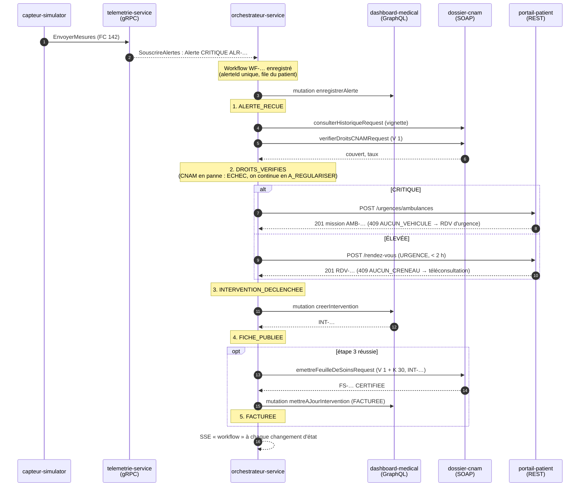

# orchestrateur-service (REST, port 8085)

Chef d'orchestre du workflow d'alerte : il reçoit les alertes de `telemetrie-service` (gRPC) puis appelle, dans
l'ordre, les trois autres services, chacun dans son protocole (SOAP, REST, GraphQL). Chaque étape est tracée et
consultable en REST, et diffusée en direct (SSE).

## Rôle

- **Abonnement aux alertes** : au démarrage, abonnement gRPC `SouscrireAlertes` (tous les patients, niveau ≥ ÉLEVÉE).
  Si le flux se coupe ou si telemetrie est absent, reconnexion automatique avec un backoff de 1 s, 2 s, 4 s…
  jusqu'à 30 s.
- **Un workflow par alerte**, exécuté en arrière-plan :
  - une **file par patient** : les alertes d'un même patient sont traitées dans l'ordre, une à la fois ;
  - les patients différents sont traités **en parallèle** (threads virtuels) ;
  - **idempotence** : l'`alerteId` est unique. Une alerte reçue deux fois renvoie le workflow existant.

### Les 5 étapes

| # | Étape | Appel | Règles |
|---|---|---|---|
| 1 | `ALERTE_RECUE` | GraphQL `enregistrerAlerte` | Le workflow est enregistré d'abord, puis l'alerte est publiée sur le dashboard (mutation idempotente). |
| 2 | `DROITS_VERIFIES` | SOAP `consulterHistorique` (vignette) puis `verifierDroitsCNAM` | Acte CRITIQUE → `V 1`, ÉLEVÉE → `CS 1`. Non couvert → `A_REGULARISER`. **CNAM indisponible → étape ECHEC mais le workflow continue**, couverture inconnue et `A_REGULARISER`. |
| 3 | `INTERVENTION_DECLENCHEE` | REST portail-patient | CRITIQUE → `POST /urgences/ambulances` ; `409 MISSION_DEJA_EN_COURS` → OK (mission existante) ; `409 AUCUN_VEHICULE_DISPONIBLE` → repli sur un RDV d'urgence. ÉLEVÉE → `POST /rendez-vous` type URGENCE ; `409 AUCUN_CRENEAU_URGENCE` → repli en TELECONSULTATION « rappel du patient par le médecin référent ». Portail indisponible → ECHEC, on passe quand même à l'étape 4. |
| 4 | `FICHE_PUBLIEE` | GraphQL `creerIntervention` | La fiche est publiée même si l'intervention a échoué (le médecin doit le voir). |
| 5 | `FACTUREE` | SOAP `emettreFeuilleDeSoins` puis GraphQL `mettreAJourIntervention` | Seulement si l'étape 3 a réussi. Actes : CRITIQUE `V 1 + K 30`, ÉLEVÉE `CS 1` ; `referenceIntervention` = `INT-…`. Feuille `CERTIFIEE` → `FACTUREE`, sinon `A_REGULARISER`. Sinon étape `IGNOREE`. |

- **État final** : `FACTUREE`, ou `ECHEC` avec `etapeEnEchec` (première étape en échec).
- Chaque étape trace : nom, statut (`OK` / `ECHEC` / `IGNOREE`), horodatage, durée en ms, tentative, message.
- **Relance** (`POST /workflows/{id}/relancer`, workflow en `ECHEC` uniquement) : ne rejoue que les étapes
  manquantes. La fiche déjà créée n'est pas recréée, et une feuille déjà émise n'est jamais réémise.
- L'identifiant du workflow est dans le **MDC** (`[WF-2026-000001]` sur chaque ligne de log), et chaque changement
  d'état est publié sur le flux SSE.

### Diagramme de séquence



## Contrat

- Contrat : [`docs/openapi/orchestrateur.yaml`](../docs/openapi/orchestrateur.yaml), copié à l'identique dans
  `src/main/resources/openapi/` ; les interfaces Spring sont générées depuis cette copie.

| Méthode | Chemin | Rôle |
|---|---|---|
| `GET` | `/workflows?patientId=&etat=` | Liste filtrée, plus récent d'abord |
| `GET` | `/workflows/{id}` | Détail avec les étapes (`WF-AAAA-NNNNNN`) |
| `POST` | `/workflows/declencher` | Déclenchement manuel d'une alerte : `202` + `Location` (nouveau), `200` (alerte déjà reçue) |
| `POST` | `/workflows/{id}/relancer` | `202` ; `409 WORKFLOW_NON_RELANCABLE` s'il n'est pas en ECHEC ou s'il est en cours |
| `GET` | `/workflows/flux` | Flux SSE (`text/event-stream`), événement `workflow` |

- Erreurs : même schéma `Erreur` que le portail (`code`, `message`, `horodatage`, `details`) ; codes
  `REQUETE_INVALIDE`, `WORKFLOW_INTROUVABLE`, `WORKFLOW_NON_RELANCABLE`.
- Les clients sont, eux aussi, générés depuis des copies des contrats des autres services :

| Service appelé | Copie du contrat | Code généré / utilisé |
|---|---|---|
| telemetrie (gRPC) | `src/main/proto/telemetrie.proto` | stub `TelemetrieGrpc` (`SouscrireAlertes`) |
| dossier-cnam (SOAP) | `src/main/xsd/dossier-cnam.xsd` | classes JAXB + `WebServiceTemplate` |
| portail-patient (REST) | `src/main/contrats/portail-patient.yaml` | client openapi-generator `java` / `restclient` (`UrgencesApi`, `RendezVousApi`) |
| dashboard (GraphQL) | `src/test/resources/contrats/dashboard-medical.graphqls` | documents `src/main/resources/graphql-documents/*.graphql`, validés contre le schéma par un test |

- Swagger UI : http://localhost:8085/swagger-ui.html.

## Lancer

```powershell
cd orchestrateur-service
.\mvnw.cmd spring-boot:run
```

Pour un workflow complet, démarrer les 4 autres services (voir le README racine). Sans eux, l'orchestrateur démarre
quand même : il retente l'abonnement gRPC en arrière-plan, et les workflows déclenchés finissent en `ECHEC`
(relançables).

- **Profil par défaut** : H2 en mémoire. Console : http://localhost:8085/h2-console (`jdbc:h2:mem:orchestrateur`, utilisateur `sa`).
- **Profil `docker`** : PostgreSQL (`DB_URL`, `DB_USER`, `DB_PASSWORD`). Adresses des services : `TELEMETRIE_ADRESSE`,
  `CNAM_URL`, `PORTAIL_URL`, `DASHBOARD_URL` (par défaut les noms des conteneurs).
- **Propriétés** `sahti.*` :
  - `timeout` (3 s) : délai de connexion et de lecture de chaque appel ;
  - `telemetrie.adresse`, `cnam.url`, `portail.url`, `dashboard.url` ;
  - `alertes.abonnement-actif` (`true`), `alertes.reconnexion-min` (1 s), `alertes.reconnexion-max` (30 s).

```powershell
docker build -t sahticonnect/orchestrateur-service .
```

## Tester

```powershell
# 34 tests :
#  - WorkflowAlerteServiceTest : un test par scénario (PAT-0001 CRITIQUE facturé, PAT-0002 non couvert,
#    PAT-0003 ÉLEVÉE → RDV, CNAM en panne, portail en panne, aucun créneau → téléconsultation, mission déjà
#    en cours, aucun véhicule → RDV, relance, feuille non réémise) ;
#  - OrchestrateurAlertesTest : idempotence, ordre par patient, parallélisme entre patients, règles de relance ;
#  - OrchestrateurIntegrationTest : WireMock (REST, SOAP, GraphQL), retry sur 503, pas de retry sur Fault Client
#    ni sur une création sans réponse, repli, relance, erreurs du contrat ;
#  - AbonnementAlertesTest : faux telemetrie gRPC in-process, reconnexion avec backoff ;
#  - ContratsTest : copies identiques à docs/, documents GraphQL valides
.\mvnw.cmd verify

# Service démarré : déclenchement manuel, suivi des étapes, idempotence et erreurs
..\docs\tests\orchestrateur\tester-orchestrateur.ps1
..\docs\tests\orchestrateur\tester-orchestrateur.ps1 -Patient PAT-0002 -Niveau CRITIQUE   # vignette expirée

# Démo de bout en bout (les 5 services démarrés) : capteur en tachycardie → workflows → fiche GraphQL → feuille SOAP
..\docs\tests\e2e\demo.ps1
```

Flux en direct : `curl.exe -N http://localhost:8085/workflows/flux`.

## Choix techniques

- **Orchestration** plutôt que chorégraphie : un seul composant connaît l'ordre des étapes, les replis et l'état
  de chaque workflow. Il est donc facile à tracer, à relancer et à expliquer.
- **Résilience4j par client** (`@Retry` autour de `@CircuitBreaker`) :
  - timeout de 3 s appliqué au transport (client HTTP JDK pour REST et GraphQL, `HttpUrlConnectionMessageSender`
    pour SOAP) : l'appel s'interrompt vraiment, aucun thread n'est bloqué. Le flux gRPC `SouscrireAlertes`,
    lui, n'a pas de deadline : il est ouvert en permanence, et sa coupure déclenche la reconnexion ;
  - retry 3 tentatives, backoff exponentiel (500 ms, 1 s), **uniquement sur les erreurs techniques**. Jamais sur
    une erreur métier (4xx du portail, SOAP Fault `Client`, `NOT_FOUND` GraphQL) ;
  - **deux politiques** : `appel-idempotent` (lectures, `enregistrerAlerte`, `mettreAJourIntervention`) est
    réessayé sur toute panne. `appel-non-idempotent` (ambulance, RDV, feuille de soins, `creerIntervention`) n'est
    réessayé que si la connexion a échoué, car après un délai de réponse dépassé la création a peut-être eu lieu ;
  - un circuit breaker par service (50 % d'échecs sur 10 appels → ouvert 30 s) : un service en panne ne ralentit
    plus chaque workflow de 3 × 3 s.
- **GraphQL : `HttpSyncGraphQlClient`**, la variante synchrone de `HttpGraphQlClient` : le workflow est séquentiel
  et tourne sur des threads virtuels, donc pas besoin de Reactor.
- **SSE écrit à la main** (`SseEmitter`) : l'opération `/workflows/flux` est exclue de la génération
  (`openapiNormalizer FILTER`), car l'interface générée ne sait pas renvoyer un flux.
- **Idempotence en base** : contrainte unique sur `alerte_id`. Deux réceptions simultanées → la seconde relit le
  workflow créé par la première.
- **File par patient** : `CompletableFuture` chaînés par patient sur un exécuteur à threads virtuels, sans verrou
  ni file de messages.
- **Identifiants** `WF-AAAA-NNNNNN` tirés d'une séquence en base (`workflow_seq`).
