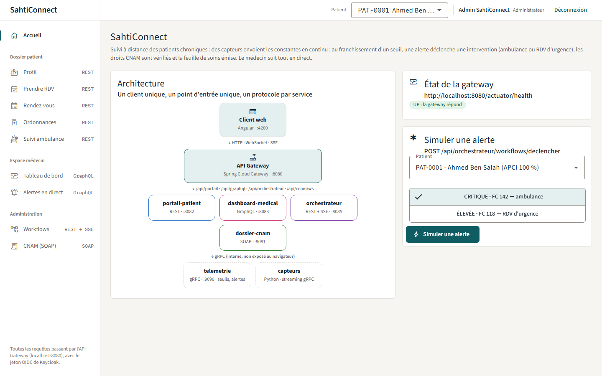
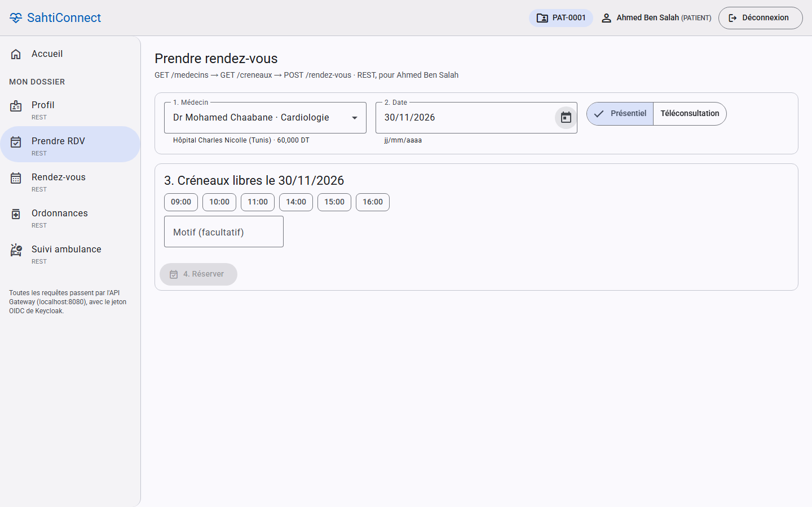
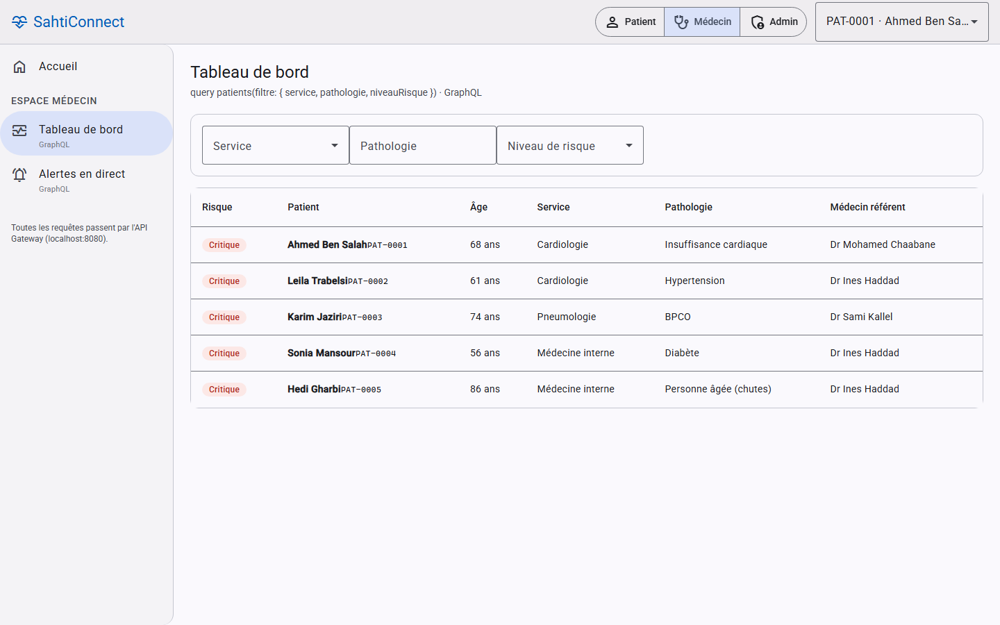
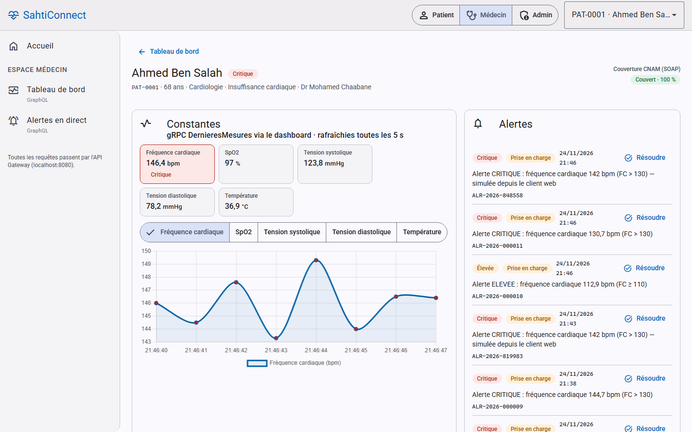
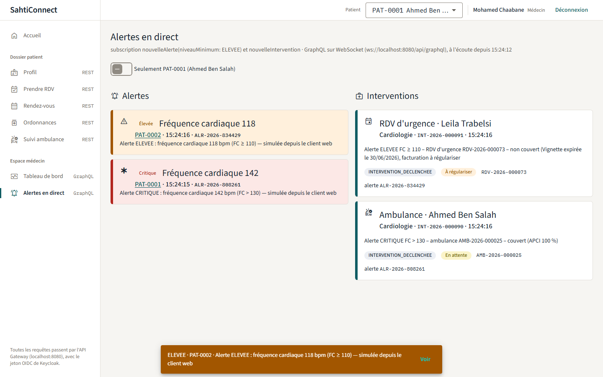
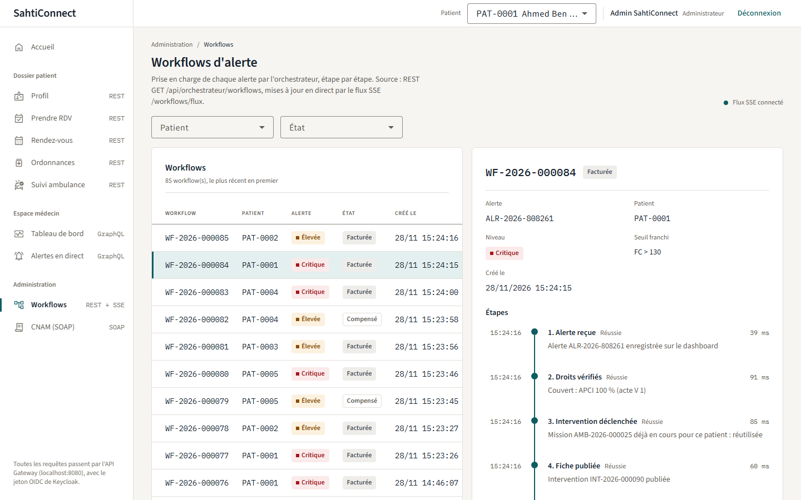
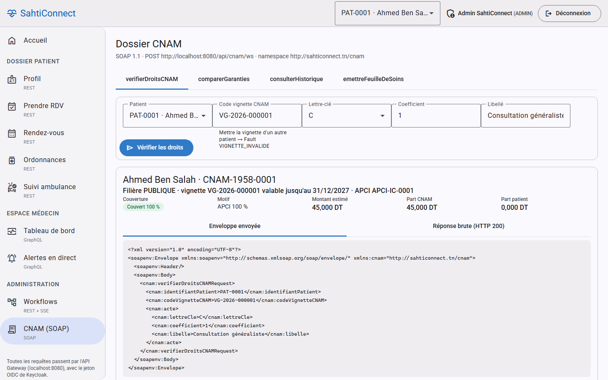
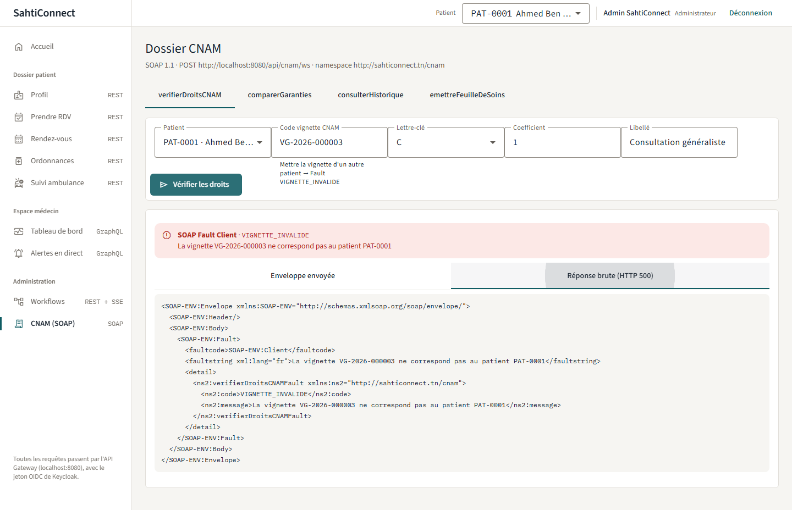
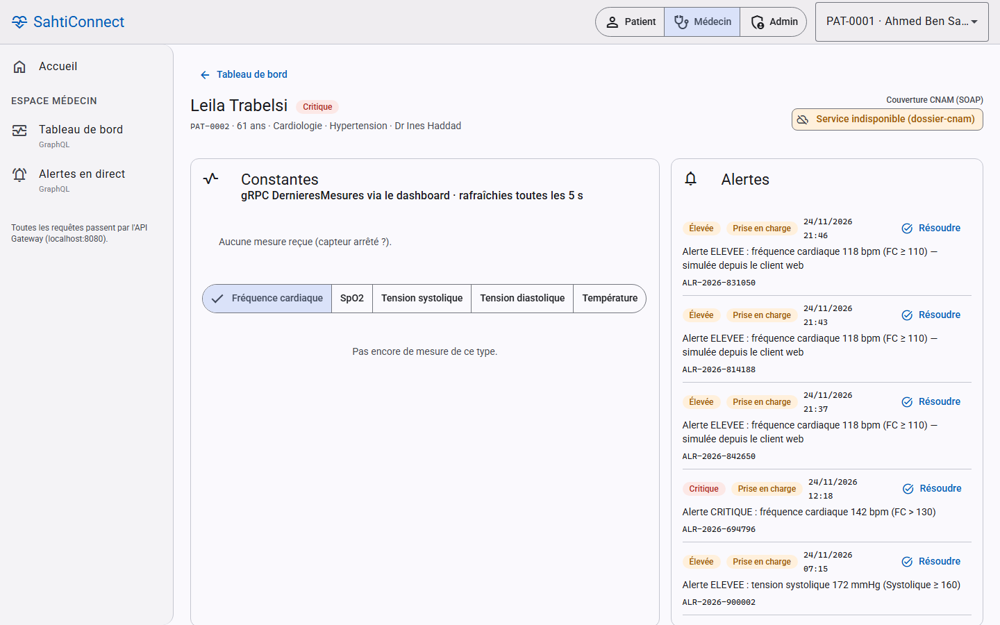
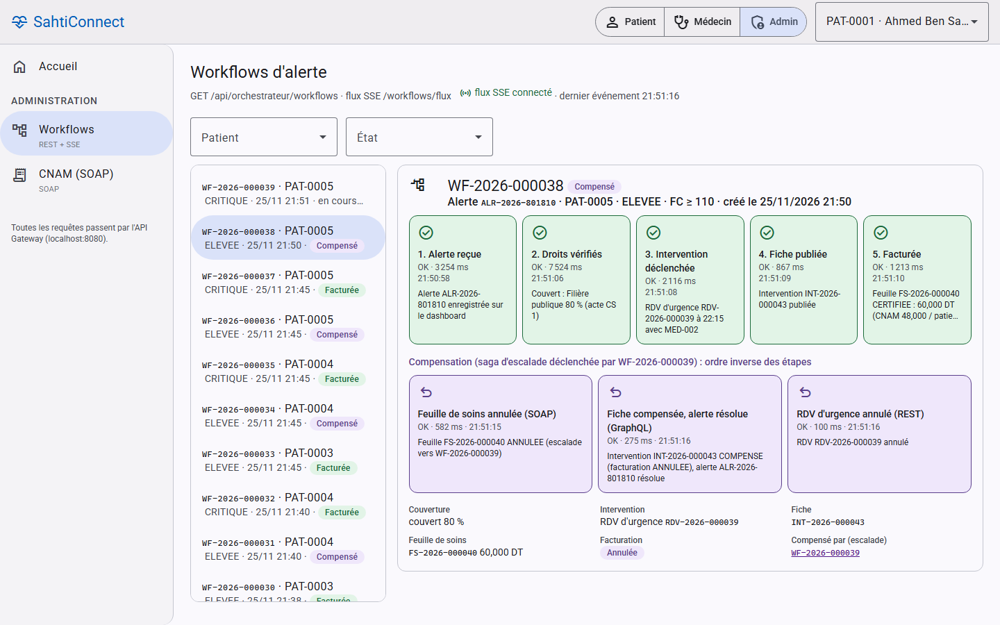

# web-client (Angular, port 4200)

Client web unique de SahtiConnect. Il consomme les 4 types de services (REST, GraphQL, SOAP, SSE), et
**toutes ses requêtes passent par l'API Gateway** (http://localhost:8080), jamais directement par un service.

## Rôle

Un sélecteur de **rôle** (Patient / Médecin / Admin) et un sélecteur de **patient** (PAT-0001 … PAT-0005) dans la barre
du haut, mémorisés dans le `localStorage`. Chaque rôle a son menu.

| Écran | Rôle | Protocole (via la gateway) | Ce qu'il montre |
|---|---|---|---|
| Accueil | tous | REST + actuator | Présentation, schéma d'architecture, état de la gateway (`/actuator/health`, toutes les 10 s), **« Simuler une alerte »** (`POST /workflows/declencher`) |
| Mon profil | Patient | REST `GET`/`PUT /patients/{id}` | Coordonnées modifiables ; erreurs 400 (`details`) et 409 `EMAIL_DEJA_UTILISE` affichées **sur les champs** |
| Prendre RDV | Patient | REST `/medecins` → `/creneaux` → `POST /rendez-vous` | Médecin → date → créneaux libres → réservation |
| Mes RDV | Patient | REST `/rendez-vous` (`PUT`, `DELETE`) | Liste, déplacement (créneaux libres du même médecin), annulation |
| Ordonnances | Patient | REST `/patients/{id}/ordonnances?actives=` | Filtre « actives » |
| Suivi ambulance | Patient | REST `/urgences/ambulances/{id}` | État d'une mission AMB-…, rafraîchi toutes les 10 s |
| Tableau de bord | Médecin | GraphQL `patients(filtre)` | Patients avec badge de risque, filtres service / pathologie / niveau |
| Fiche patient | Médecin | GraphQL `patient(id)` + `historiqueSoins` + `resoudreAlerte` | **Une seule requête** : profil, couverture (SOAP), constantes (gRPC), alertes, traitements, interventions. Graphique des constantes (Chart.js) rafraîchi toutes les 5 s, historique paginé, bouton « Résoudre » |
| Alertes en direct | Médecin | GraphQL **subscriptions** (WebSocket) | `nouvelleAlerte` → liste en temps réel + notification colorée ; `nouvelleIntervention` → fiche qui apparaît |
| Workflows | Admin | REST `/workflows` + **SSE** `/workflows/flux` | Liste filtrée, frise des 5 étapes (statut, durée, message) mise à jour en direct, « Relancer » si ECHEC. Saga d'escalade : badge « Compensé », étape ESCALADE du workflow CRITIQUE, ligne des compensations (ordre inverse) |
| CNAM (SOAP) | Admin | **SOAP** `/api/cnam/ws` | Les 4 opérations, résultat lisible, Fault avec son code, onglet « XML » (enveloppe envoyée, réponse brute) |

### Comment chaque protocole est consommé

| Protocole | Côté client | Généré depuis |
|---|---|---|
| REST (portail, orchestrateur) | `PortailService`, `OrchestrateurService` (HttpClient) | `docs/openapi/*.yaml` → openapi-generator `typescript-angular` |
| GraphQL (dashboard) | Apollo Angular : un service par opération (`FichePatientGQL`…) ; HTTP pour les queries et mutations, **WebSocket** (`graphql-ws`) pour les subscriptions | `docs/graphql/dashboard-medical.graphqls` + `src/app/graphql/*.graphql` → graphql-codegen |
| SOAP (CNAM) | `CnamSoapService` : enveloppes XML construites dans l'ordre des `xs:sequence`, réponses et Faults lues avec `DOMParser` | types écrits à la main d'après `docs/wsdl/dossier-cnam.xsd` (`cnam.types.ts`) |
| SSE (orchestrateur) | `FluxWorkflowsService` : `EventSource` encapsulé dans un Observable, reconnexion automatique | – |
| gRPC (telemetrie) | **non consommé directement** : le navigateur ne parle pas gRPC. Les constantes arrivent par GraphQL (le dashboard appelle telemetrie), les alertes par la subscription `nouvelleAlerte` | – |

### Gestion des erreurs

- **Intercepteur HTTP** : toute erreur est lue au format `Erreur` du contrat (y compris le 503 `SERVICE_INDISPONIBLE` de la
  gateway). Un snackbar affiche le code, le message, le service en cause et le **`X-Correlation-Id`** renvoyé par la
  gateway, pour retrouver la requête dans les journaux.
- **Réponses GraphQL partielles** (`errorPolicy: 'all'`) : un champ distant en panne (couverture SOAP, constantes gRPC,
  historique) est remplacé par une puce **« Service indisponible (dossier-cnam) »**. Le reste de la fiche s'affiche
  normalement.
- **SOAP** : la Fault (`Client` ou `Server`) est affichée dans l'écran CNAM avec le code de son `<detail>`
  (`VIGNETTE_INVALIDE`, `PATIENT_INCONNU`, `SERVICE_INDISPONIBLE`…).
- **SSE** : coupure réseau → l'`EventSource` se reconnecte seul. Flux fermé (503 de la gateway) → nouvelle tentative
  après 1 s, 2 s, 4 s… jusqu'à 30 s. L'état du flux est affiché.
- **Subscriptions** : `graphql-ws` se reconnecte avec un délai croissant.

### Format tunisien

Locale `fr-TN` : dates `24/11/2026 14:30` à l'heure de Tunis (UTC+1), montants avec le pipe `dt` (`145,000 DT`,
toujours 3 décimales).

### Captures d'écran

Prises par Playwright contre la stack Docker (`npm run captures`), dans [`docs/captures/`](../docs/captures/).

| | |
|---|---|
|  Accueil |  Prise de RDV (REST) |
|  Tableau de bord (GraphQL) |  Fiche patient (GraphQL) |
|  Alertes en direct (subscriptions) |  Workflows (REST + SSE) |
|  CNAM (SOAP) |  SOAP Fault et XML brut |
|  Réponse partielle : dossier-cnam arrêté, seule la couverture est remplacée par la puce |  Saga d'escalade : workflow ELEVEE « Compensé », compensations en ordre inverse |

## Contrat

Le client n'a pas de contrat propre : il est **généré depuis ceux des services** (`docs/`, source de vérité).

```powershell
npm run generate:api       # docs/openapi/portail-patient.yaml, orchestrateur.yaml → src/app/api/ (openapi-generator 7.16.0)
npm run generate:graphql   # docs/graphql/dashboard-medical.graphqls + src/app/graphql/*.graphql → src/app/graphql/generated.ts
npm run generate           # les deux (lancé automatiquement avant start, build et test)
```

- Le code généré n'est **pas versionné** (`.gitignore`). Il est régénéré à chaque build, y compris dans l'image Docker.
- Une opération GraphQL qui ne respecte pas le schéma fait échouer la génération. Un contrat REST qui change casse la
  compilation là où le client l'utilise.
- `SET_TAGS_FOR_ALL_OPERATIONS` regroupe chaque contrat REST en un seul service (les tags accentués du portail, comme
  « Médecins », donneraient sinon des noms de classe peu lisibles).

## Lancer

Prérequis : **Node ≥ 22.22** (Angular 22), et Java pour openapi-generator (déjà présent pour les services).

```powershell
cd web-client
npm install
npm start                  # génère les clients puis http://localhost:4200 (la gateway doit tourner sur 8080)
```

Avec Docker, le client fait partie de la stack : `docker compose up --build -d`, puis http://localhost:4200.
- **Image** : build multi-stage. Une étape Node (avec un JRE pour openapi-generator) génère les clients depuis
  `docs/` puis construit l'application. L'étape finale nginx sert les fichiers statiques, avec un repli vers
  `index.html` pour le routing Angular (`nginx.conf`).
- **Conteneur** : port 4200 sur la machine, `depends_on: api-gateway (healthy)`.

## Tester

```powershell
npm test                   # 24 tests unitaires (Vitest) :
                           #  - CnamSoapService : enveloppes des 4 opérations, réponses, Fault Client, Fault de la gateway, transport ;
                           #  - intercepteur d'erreurs : schéma Erreur, X-Correlation-Id, details par champ, SANS_NOTIFICATION ;
                           #  - pipe dt ; flux SSE (événements, reconnexion avec délai croissant, désabonnement) ;
                           #  - composants : fiche patient avec réponse partielle (puces), frise du workflow (statuts, relance)

# Bonus Playwright, contre la stack Docker complète (docker compose up -d) ; inclut la saga d'escalade (badge « Compensé »)
npx playwright install chromium   # une fois
npm run e2e                # un patient prend un RDV ; « Simuler une alerte » → alerte en direct côté médecin
                           # (WebSocket) → workflow FACTUREE côté admin (SSE)
npm run captures           # régénère docs/captures/
```

## Choix techniques

- **Angular 22.3** (dernière version stable) : composants standalone, signals, détection des changements sans zone.js
  (zoneless), routes en lazy loading (un chunk par écran), nouvelle syntaxe de contrôle (`@if`, `@for`).
- **Angular Material 3**, thème clair (azur et cyan) et couleurs de niveau dédiées (critique, élevée, modérée,
  faible). Mise en page responsive : menu en tiroir sous 900 px.
- **Bundle initial** : environ 1 Mo (217 ko compressé), surtout Angular Material. Chart.js n'est chargé qu'avec la fiche
  patient. Les budgets d'`angular.json` sont fixés à 1,1 / 1,5 Mo.
- **Apollo Client 4** : les options par défaut (`errorPolicy: 'all'`) sont déclarées par augmentation de module, ce qui
  type les résultats en conséquence. Le lien est séparé : HTTP pour les queries et mutations (via HttpClient, donc via
  l'intercepteur), WebSocket pour les subscriptions.
- **graphql-codegen** : `typescript-operations` (v7) génère lui-même les enums et inputs utilisés, en types union.
  Le plugin `typescript` n'est donc pas ajouté (il les aurait déclarés en double).
- **SOAP sans bibliothèque** : un navigateur n'a pas de pile SOAP. Construire l'XML à la main, dans l'ordre exact du
  XSD, et le relire avec `DOMParser` suffit pour 4 opérations, et montre ce qu'est réellement une enveloppe.
- **EventSource plutôt qu'une bibliothèque SSE** : natif, reconnexion intégrée. L'Observable ajoute la reconnexion
  quand le flux est fermé et la fermeture au désabonnement.
